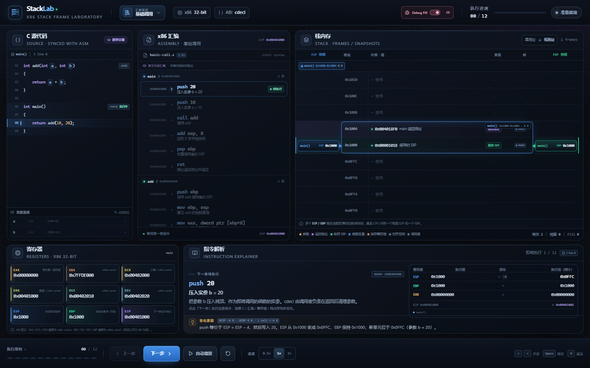
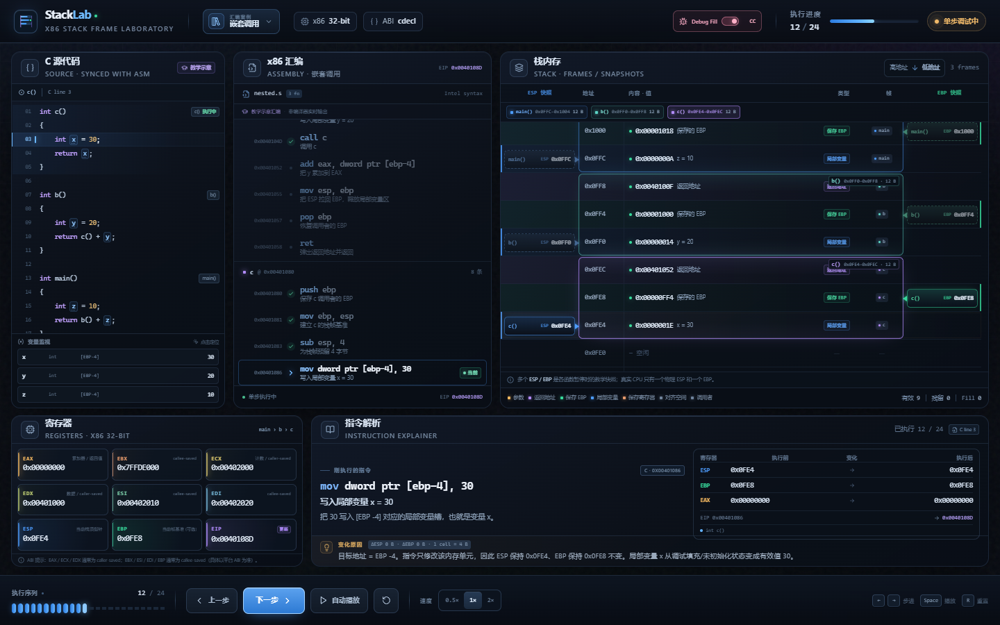
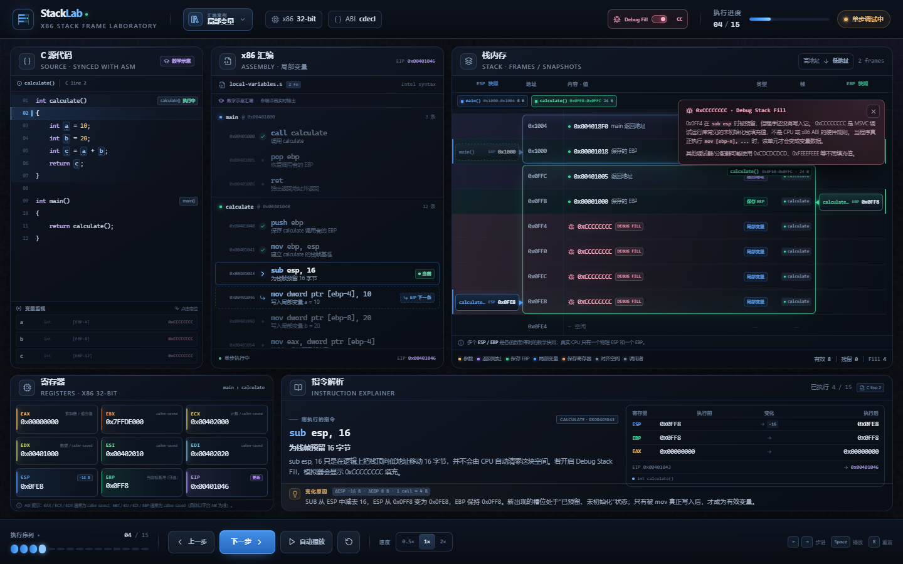
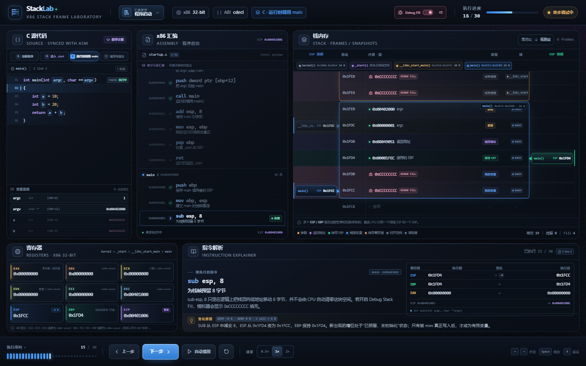

# StackLab · x86 函数栈帧可视化实验室

StackLab 是一个面向汇编 / 嵌入式初学者的交互式 x86 32-bit 栈帧模拟器。它把 **C 源码、汇编执行、CPU 寄存器、栈帧边界、函数历史 ESP 快照** 放在同一个由真实模拟状态驱动的界面中。

当前版本是二期升级：在原有纯状态模拟引擎、快照时间线、Zustand 播放控制的基础上，增加了 C/汇编双代码面板、栈帧框选、多函数 ESP/EBP 历史标记、callee-saved 寄存器、Debug Stack Fill、启动过程和案例库。



## 功能亮点

### 1. C 源码与汇编同步

- 左侧显示完整 C 代码，当前函数背景高亮，当前 C 行高亮。
- 每条汇编指令都带有 `cLine` 映射；一条 C 语句对应多条汇编时，该 C 行会持续保持高亮。
- 变量（如 `x`、`y`、`a`、`b`、`c`）在 C 代码中可点击。
- 变量面板实时显示值、栈位置或寄存器位置。
- 点击栈变量 → 自动滚动并高亮对应栈单元；点击寄存器变量 → 高亮对应寄存器，不会伪造栈地址。



### 2. 栈帧范围框选

- 每个活动函数有独立颜色的半透明边框和顶部标签。
- 标签显示函数名、起止地址、占用字节数；保存过寄存器时显示 `saved EBX / ESI / EDI`。
- 框的边界来自当前指令执行后的真实内存单元，而不是固定尺寸。
- `sub esp`、`push`、`pop`、`mov esp, ebp` 会改变框的大小。
- 函数返回后，活动框消失，内存和框变为灰色的“历史残留”区域；不会清零。

### 3. 每个函数的 ESP / EBP 快照

- 当前函数 ESP 使用高亮蓝色箭头，历史调用者使用淡色虚线箭头。
- EBP 使用绿色箭头。
- 箭头直接落在对应内存行，旁边标注 `函数名() ESP/EBP + 地址`。
- 栈帧名册和每个指针对象都带有函数归属。
- UI 中明确说明：**多个 ESP/EBP 是教学用的函数调用阶段快照，真实 CPU 只有一个物理 ESP 和一个 EBP。**

### 4. callee-saved 寄存器

案例“保存 EBX、ESI、EDI”和“寄存器变量”覆盖：

- `push ebx / esi / edi` 真实改变 ESP，并在栈单元标记“保存寄存器”。
- 函数执行期间修改寄存器。
- 返回前按相反顺序 `pop edi / esi / ebx`。
- 寄存器面板在每一步显示当前值和变化；结束后恢复调用前数值。
- 没有修改 callee-saved 寄存器的案例不会强行保存它们。
- ABI 提示中说明这是 x86-32 cdecl 的典型约定，并非所有架构通用。

### 5. Debug Stack Fill

顶部 `Debug Fill` 开关控制 `sub esp, N` 预留区域的显示：

- 开启：未初始化的新局部变量槽显示 `0xCCCCCCCC`，粉红色高亮并标记 `DEBUG FILL`。
- 关闭：不进行人为填充，显示“已预留 · 未初始化”。
- 真实 `mov [ebp−n], value` 写入后，该单元才变成有效变量。
- `PUSH` 永远写入真实寄存器 / 立即数，不会被填充值污染。
- 点击填充行会弹出解释：`0xCCCCCCCC` 是 MSVC 调试运行库常见的未初始化栈填充模式，不是 CPU 或 ABI 的硬件规则。
- 备注中同时说明 `0xCDCDCDCD`、`0xFEEEFEEE` 等其他调试环境模式。



### 6. Linux ELF 启动过程

“程序启动”案例展示：

- 阶段 A：内核建立初始栈，栈上已有 `argc`、`argv`、`envp`、`auxv`。
- 阶段 B：进入 ELF 入口 `_start`，说明 `_start ≠ main`。
- 阶段 C：简化运行时 `__libc_start_main` 准备参数并 `call main`，main 建立自己的 EBP 栈帧。
- 阶段 D：main 返回运行时，运行时返回 `_start`，最终通过 `int 0x80` 的 exit 系统调用退出。
- 进程退出后活动栈帧关闭，栈内容保留为历史残留。

> 这是简化的 Linux ELF / glibc 概念模型，并不是对某个 glibc 版本的逐指令复刻；真实启动流程取决于 OS、CRT、编译器和 ABI。



### 7. 案例库

固定内置 6 个案例，均可在顶部“汇编案例”中切换；切换会重建时间线并回到第 0 步。

| 案例 | 指令数 | 学习重点 | 结束结果 |
| --- | ---: | --- | --- |
| 最简单的函数调用 | 12 | CALL / RET / 参数 / 返回地址 | EAX = 30 |
| 带局部变量的函数 | 15 | EBP、`sub esp,16`、`[ebp−n]`、Debug Fill | 返回值 30 |
| 保存 EBX、ESI、EDI | 27 | callee-saved 保存/恢复、对齐空间、残留数据 | 返回值 40 |
| main() 之前的启动过程 | 30 | 初始栈、_start、运行时、main、exit | main 返回 30，exit 0 |
| 嵌套函数调用 | 24 | main → b → c、三帧框选、多 ESP 历史 | 返回值 60 |
| 寄存器变量（优化概念） | 14 | 变量提升到 EBX/ESI、省略 EBP、ESP 相对寻址 | 返回值 30 |

> 非启动案例从 `main` 序言完成之后开始，以聚焦子函数栈帧。完整展示 main 如何被运行时调用、如何建立自己栈帧的是“程序启动”案例。


## 当前支持的指令语义

模拟器按真实寄存器和栈单元逐条执行，不是只改 UI：

- `PUSH imm32 / reg / dword ptr [ebp+disp]`
- `POP reg`
- `CALL function`：压入返回地址、创建 callee 帧、迁移参数归属
- `RET`：弹出返回地址、归档 callee 帧、恢复调用者
- `MOV reg, imm` / `MOV reg, reg`
- `MOV reg, dword ptr [ebp/esp+disp]`
- `MOV dword ptr [ebp+disp], imm/reg`
- `ADD reg, dword ptr [ebp/esp+disp]` / `ADD reg, reg`
- `SUB esp, imm`
- `ADD esp, imm`
- `MOV esp, ebp`
- `MOV ebp, esp`
- `XOR reg, reg`
- `INT 0x80`（简化 Linux exit 模型）
- `NOP`

每条指令都有中文标题、解释、变化原因以及执行前后的 ESP / EBP / EAX 对比。

## 运行

```bash
npm install
npm run dev
```

打开终端中 Vite 输出的地址（默认 `http://127.0.0.1:5173/`）。

生产构建：

```bash
npm run build
npm run preview
```

快捷键：`←` / `→` 单步，`Space` 播放或暂停，`R` 重置。

## 架构

```
src/
  simulator/
    types.ts          # CPUState / MemoryCell / StackFrame / Scenario 类型
    ops.ts            # PUSH/POP/帧创建/释放/残留/终止进程等真实状态操作
    assembler.ts      # 汇编语义 DSL、地址计算、中文解释、指令构建
    scenarios.ts      # 6 个案例、C 源码、变量映射、执行顺序
    engine.ts         # 预计算快照时间线
    utils.ts          # 十六进制、状态克隆、模板渲染
  store/
    simulatorStore.ts # 案例切换、Debug Fill、步进、回退、自动播放、变量聚焦
  components/
    SourcePanel.tsx   # C 源码、当前行、函数高亮、变量定位
    CodePanel.tsx     # 当前 / EIP 下一条双状态代码高亮
    StackMemory.tsx   # 栈行、帧框、多 ESP/EBP、Debug Fill、残留
    RegisterDock.tsx  # 9 个寄存器、变化高亮、寄存器变量聚焦
    InstructionPanel.tsx
    CaseLibrary.tsx
    Header.tsx / ControlBar.tsx / PanelHeader.tsx / Logo.tsx
  ui/
    variables.ts      # C 变量 → 栈地址 / 寄存器 / 作用域解析
    meta.ts
  styles-v2.css       # 二期布局与视觉
```

原则：**模拟状态是唯一事实来源。** 动画只读取状态快照，不修改状态；回退直接恢复历史快照。

## 真实性与限制

- 所有内置案例均明确标注为 **教学示意汇编**，不是 GCC / Clang / MSVC 的实时输出。
- 当前没有接入真实 C 编译器。案例库中的“编译器档案”只描述来源和 ABI，不宣称已完成实时编译。
- 未实现：用户输入 C 代码 → 调用真实编译器 → 导入汇编。
- 未模拟：真实指令字节长度、ELF 重定位、动态链接细节、完整 glibc 启动参数、内核系统调用实现。
- 栈地址、返回地址为教学可读值；指令地址是按教学规模估算的合理布局。
- Linux `_start` / `__libc_start_main` 流程已明确标注为简化模型。
- 优化案例是优化概念示意，不宣称由某个具体编译器在某个优化等级下生成。

## 已验证

- 6 个案例全部执行完成，结果分别为 30 / 30 / 40 / 30(exit 0) / 60 / 30。
- CALLEE-SAVED 案例结束时 EBX、ESI、EDI 恢复为初始值。
- Debug Fill 开启时 `sub esp` 槽位显示 `0xCCCCCCCC`，关闭后显示未初始化；切换会重置快照。
- 上一步可恢复内存、寄存器、帧框、ESP/EBP 历史与 C 行。
- 嵌套案例三帧框不重叠；所有 ESP/EBP 指针动画结束后与目标行垂直误差 < 1px。
- 1440×900、1280×800、1920×1080 无页面溢出；构建通过；控制台无错误。
