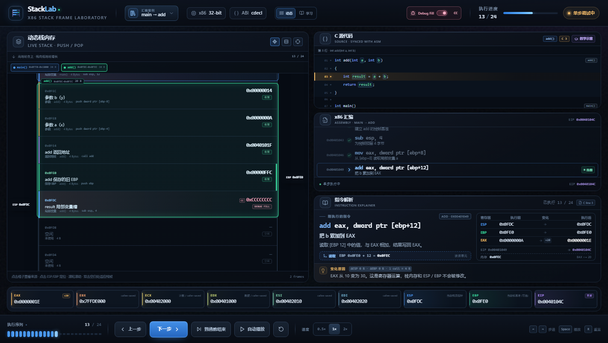

# StackLab · x86 函数栈帧可视化实验室

StackLab 是一个面向汇编 / 嵌入式初学者的交互式 **x86 32-bit 栈帧模拟器**。它不是动画演示：每一条指令都会真实修改模拟器里的寄存器、内存、ESP/EBP 和函数栈帧，C 源码、汇编、动态栈、寄存器、指令解释全部读同一份状态快照。

项目只有两个入口：

- **动态**（默认）：左侧连续内存柱 + ESP/EBP 指针 + 栈帧框；右侧 C 源码 → x86 汇编 → 指令解释；底部寄存器与执行控制。
- **学习**：C 源码 + 变量监视 / 汇编 / 栈内存详细表格三栏对照，适合逐条抠地址和来源。



---

## 怎么打开

### 1. 直接打开（服务已启动时）

浏览器访问：

```
http://127.0.0.1:5173/
```

如果这个地址打不开，说明开发服务器没在跑，按下面第 2 步启动。

### 2. 自己启动

需要 Node.js 18+（本项目在 Node 24 上验证过）。

```bash
cd G:\study\vibecoding\StackLab
npm install        # 第一次拉下来才需要
npm run dev
```

终端会打印：

```
VITE v6.x  ready
➜  Local:   http://127.0.0.1:5173/
```

把 `http://127.0.0.1:5173/` 粘到浏览器即可。`Ctrl + C` 停止。

### 3. 其他命令

```bash
npm run verify     # 无头验收：8 个案例跑完整时间线，132 项断言
npm run typecheck  # TypeScript 检查
npm run build      # 生产构建到 dist/
npm run preview    # 预览构建产物（默认 http://127.0.0.1:4173/）
```

> 直接双击 `dist/index.html` 打不开：Vite 产物使用绝对路径，需要 `npm run preview` 或任意静态服务器。

### 4. 快捷键

| 按键 | 作用 |
| --- | --- |
| `←` / `→` | 上一步 / 下一步 |
| `Space` | 自动播放 / 暂停 |
| `R` | 重置到第 0 步 |

### 5. 深链（可直接定位到某一步）

```
/?case=startup&step=13            # CALL main 之后
/?case=main-add&step=13           # add 正在执行，两个栈帧并存
/?case=main-add&step=18           # add 已返回，残留数据
/?layout=learn                    # 切到学习页
```

`case` 取值：`startup`、`main-locals`、`basic-call`、`main-add`、`callee-saved`、`nested`、`local-variables`、`optimized-registers`。

---

## 动态页

### 布局

```
┌───────────────────────────────┬──────────────────────────────┐
│ 动态栈内存                     │ C 源代码                      │
│  高地址 ↑                     ├──────────────────────────────┤
│  ┌─────────────────────────┐  │ x86 汇编（当前指令高亮）        │
│  │ 0x1FFC   0x00003000     │  ├──────────────────────────────┤
│  │ 保存的旧 EBP             │  │ 指令解释（寄存器/内存/原因）    │
│  └─────────────────────────┘  │                              │
│ ESP ─►            ◄─ EBP      │                              │
├───────────────────────────────┴──────────────────────────────┤
│ CPU 寄存器：EAX EBX ECX EDX ESI EDI ESP EBP EIP               │
├──────────────────────────────────────────────────────────────┤
│ 上一步  下一步  到函数结束  自动播放  暂停  重置  速度  进度     │
└──────────────────────────────────────────────────────────────┘
```

### 动态栈怎么画

- **一条连续内存柱**：格子之间只有 1px 分隔线，外层一个圆角容器统一包住；高地址在上、低地址在下，两端标出地址边界。没有「一列卡片」的间距和阴影。
- **每格 64px**（紧凑模式 50px）：左上地址、右上十六进制数值、中间用途、底部「类型 · 所属函数 · 4 Bytes · 来源指令」。左侧 3px 色条表示类型。
- **统一坐标系**：格子、帧框、指针、滚动锚点都用 `PAD_TOP + 行号 × 格高`。帧框的上下边界直接由 `stackEnd` / `stackStart` 的行号算出，并内缩 2px——实测每个帧相对首格 +2px、末格 -2px，滚动、切换密度后保持不变，相邻帧之间留 4px 空隙。
- **ESP / EBP**：容器左右两侧的真实指针，蓝色 ESP、绿色 EBP，箭头对准格子中线；`mov ebp, esp` 只移动 EBP，`push ebp` 只移动 ESP。EBP 落在模拟栈区间之外时（如 main 序言前的调用者 EBP = 0x1018），显示「EBP 0x1018 · 栈外」虚线标记，不画指错格子的箭头。
- **栈帧**：初始进程栈灰蓝、`__libc_start_main` 琥珀、main 蓝、add 绿；标签贴在框的上沿，显示函数名、地址范围、字节数。函数 `ret` 后框淡出，格子变成灰色「已释放」残留（不清零）。顶部帧图例始终列出所有活动帧。
- **动画**：PUSH/CALL 时新格从上方落下并闪一下，POP/RET 时格子抬起；`sub esp` / `add esp` 改变帧框高度；指针弹簧移动。动画只读 `lastEffect` 与前后快照，不写状态，所以动画没结束就点「上一步」也不会数据错位。

### 三区联动

```
C 源代码（当前行高亮） → x86 汇编（当前指令高亮） → 动态栈（格子/指针/帧框变化）
```

- 每条汇编都带 `cLine`：执行 `mov dword ptr [ebp-4], 10` 时，C 面板高亮 `int a = 10;`，左侧 0x0FF8 格子同时变成 `0x0000000A / 有效`。
- `push ebp` / `mov ebp, esp` 这类编译器生成的序言会明确提示「不直接对应某一条 C 语句」，不假装映射到某行。
- 点击 C 代码里的变量名 → 动态栈对应格子高亮并滚动；寄存器变量则高亮寄存器。
- 点击动态栈格子 → 弹出单元详情（地址 / 值 / 大小 / 用途 / 类型 / 所属函数 / 初始化 / 来源指令 / 状态）。
- 点击汇编任意一行 → 右侧讲解切到那条指令（显示它执行前后的状态），不改变当前步；点「返回」回到当前指令。

---

## 学习页

三栏对照：

- 左：C 源码（当前行/函数高亮）+ 变量监视（点击定位栈或寄存器）；
- 中：x86 汇编列表（当前 / 下一条 / 已执行三态）；
- 右：栈内存详细表格（ESP/EBP 快照、地址、值、类型、帧、初始化、来源指令）；
- 底：9 个寄存器 + 指令解析。

---

## 案例库

| # | 案例 | 指令数 | 学习重点 | 结果 |
| --- | --- | ---: | --- | --- |
| 1 | 程序启动（默认） | 33 | 初始进程栈、_start、运行时、CALL main、main 建帧、exit | main 返回 30，exit 0 |
| 2 | main 的局部变量 | 12 | CALL 只压返回地址；push ebp / mov ebp,esp；sub esp 只预留；[ebp−n] 寻址 | 30 |
| 3 | 最简单的函数调用 | 12 | 参数入栈、CALL / RET、cdecl 调用者清栈 | 30 |
| 4 | main 调用 add | 24 | 两个栈帧、参数归属、EAX 返回值、帧释放 | 30 |
| 5 | 保存 EBX、ESI、EDI | 27 | callee-saved 保存与逆序恢复、对齐空间 | 40 |
| 6 | 嵌套函数调用 | 24 | main → b → c 三帧同栈、历史 ESP 快照 | 60 |
| 7 | 带局部变量的函数 | 15 | calculate() 内 Debug Fill 与 EBP 相对寻址 | 30 |
| 8 | 优化概念：寄存器变量 | 14 | 省略 EBP、变量提升到 EBX/ESI、寄存器变量没有栈地址 | 30 |

除案例 1 外，其余案例都从 main 序言之前开始（栈顶已有返回地址，但还没有 `push ebp`）；想看「零起点」请用案例 1。

---

## 程序启动实验

案例 1 共 33 步，分四个阶段（阶段边界由指令上的 `phase` 标记推导）：

| 阶段 | 内容 | 关键点 |
| --- | --- | --- |
| **A · 加载程序** | 内核映射 ELF、建立初始用户栈、设置入口地址 | 系统动作，不是 x86 指令；此时没有 main 栈帧 |
| **B · 进入 _start** | `xor ebp, ebp`、准备参数、`call __libc_start_main` | `_start` 是 ELF 入口，不是 `main` |
| **C · 运行时调用 main** | 运行时建帧、压参数、`call main`、main 建帧并跑完 | main 的返回地址由 **CALL 压入** |
| **D · 返回与退出** | main `ret` → 运行时 `ret` → `int 0x80` exit | 返回、运行时收尾、进程退出是三件事 |

`call main` 时真实发生：

```
执行前  ESP = 0x1FDC
CALL    ESP = ESP − 4 = 0x1FD8
        [0x1FD8] = 0x08049051   ← CALL 的下一条指令（运行时里回收参数的 add esp, 8）
        EIP = 0x00401000        ← main 入口
```

main 的返回地址不是 main 自己产生的；`main` 执行 `ret` 时再从栈顶取回。

---

## 指令语义

模拟器按真实寄存器和栈单元逐条执行：

- `PUSH imm32 / reg / dword ptr [ebp+disp]`、`POP reg`
- `CALL`：压返回地址、创建 callee 帧、迁移参数归属
- `RET`：弹出返回地址、归档 callee 帧、恢复调用者
- `MOV reg, imm|reg|[ebp/esp+disp]`、`MOV [ebp+disp], imm|reg`
- `ADD reg, [mem]|reg`、`LEA reg, [ebp/esp+disp]`
- `SUB esp, imm` / `ADD esp, imm` / `MOV esp, ebp` / `MOV ebp, esp`
- `XOR reg, reg`、`INT 0x80`（简化 Linux exit）、`NOP`

另有 **系统动作** `kernel: setup_initial_stack`（内核建立初始栈），界面标注「系统动作 · 非 x86 指令」。

---

## 执行控制与历史

下一步 / 上一步 / 自动播放 / 暂停 / 重置 / 到函数结束；切换案例或 Debug Fill 会重建时间线并回到第 0 步。

整条时间线在加载时预计算成快照，「上一步」恢复的是真实历史状态（寄存器、内存、帧、变量初始化全一致），不是倒放动画。`npm run verify` 里专门断言了这一点。

---

## 架构

```
src/
  simulator/
    types.ts          # CPUState / MemoryCell / StackFrame / Scenario / Instruction
    ops.ts            # PUSH/POP/帧创建/释放/残留/终止进程
    assembler.ts      # 汇编 DSL、地址计算、解释文本、LEA / 系统动作 / 序言标记
    scenarios.ts      # 8 个案例、C 源码、变量映射、执行顺序、阶段推导
    engine.ts         # 预计算快照时间线
    utils.ts          # 十六进制、状态克隆、来源指令标记、模板渲染
  store/
    simulatorStore.ts # 案例、布局、Debug Fill、步进、到函数结束、焦点、指令预览
  components/
    DynamicStack.tsx  # 连续栈柱、ESP/EBP 指针、帧框、PUSH/POP 动画
    CSourceView.tsx   # C 源码窗口（行号、高亮、变量定位）
    CodeText.tsx      # C 语法高亮（学习页与动态页共用）
    CodePanel.tsx     # 汇编列表、当前/下一条/已执行、点击查看解释
    InstructionPanel.tsx
    StackMemory.tsx   # 学习页的栈内存详细表格
    CellInspector.tsx # 内存单元详情（动态栈与表格共用）
    RegisterDock.tsx  # 9 个寄存器、变化高亮、点击设为焦点
    SourcePanel.tsx   # 学习页 C 源码 + 变量监视
    LayoutSwitcher.tsx / CaseLibrary.tsx / Header.tsx / ControlBar.tsx / PanelHeader.tsx / Logo.tsx
  ui/
    variables.ts      # C 变量 → 栈地址 / 寄存器 / 作用域
    stack.ts          # 帧标签 / 行号换算 / 单元归属 / 快照差异
    meta.ts
  styles-v2.css
scripts/
  verify.ts           # 无头不变量验收（132 项）
  ui-check-dyn.mjs    # CDP 驱动的动态栈验收
  cdp-shot.mjs        # 等动画稳定后截图
  cdp-eval.mjs        # 调试用 CDP 求值器
```

原则：**模拟状态是唯一事实来源。** 动态栈、C 面板、汇编、寄存器、解释都读同一份 `timeline[currentStep].state`；动画只读状态，不写状态。

---

## 真实性说明

- 所有内置案例都是 **教学示意汇编**，不是 GCC / Clang / MSVC 的实时输出。
- 没有接入真实 C 编译器，也没有 i686 工具链；「真实 GCC 输出」只作为来源分类保留。
- `0xCCCCCCCC` 是 MSVC 调试运行库常见的填充模式，不是 GCC/Linux 默认行为；Debug Fill 关闭时只显示「未初始化」。
- 栈地址 `0x1000` / `0x2000` 是教学简化布局，不是真实 Linux 进程的栈区间。
- 内核建立初始栈、`__libc_start_main` 调用序列是简化概念模型，界面明确标注。

---

## 已验证

- `npm run typecheck`、`npm run build` 通过。
- `npm run verify`：**132 项断言全部通过**，覆盖 8 个案例的返回值、空栈起点、CALL 返回地址、EBP 栈帧、局部变量初始化、callee-saved、三帧不重叠、到函数结束、上一步快照一致。
- 栈帧对齐用 CDP 实测：
  - 每个帧相对归属首格 `+2px`、末格 `-2px`；
  - 内部滚动 180px 后、切换紧凑密度后，数值不变；
  - ESP 箭头中心与格子中线误差 0px。
- 场景实测：初始进程栈、CALL main、push ebp、sub esp,12、CALL add、RET；C 行 / 汇编 / 栈格三区同步。
- 1440×900 与 1280×800 下无横向溢出。

---

## 已知限制 / 下一步

- 动态栈一次渲染整个区间（45–57 格），没有虚拟滚动。
- 帧很长且滚到中段时，框上沿的标签会离开视野（此时看顶部帧图例）。
- 右列三块面板高度是固定比例，暂不支持拖拽调整；窗口很矮（~700px 视口）时汇编面板只能显示 2–3 行。
- C 面板固定高度、内部滚动，小窗口一次只能看到 5–7 行。
- 动画时长固定，没有速度设置或减少动效开关。
- 真实编译器接入（输入 C → 调用 i686 gcc → 导入汇编）仍是预留接口，没有实现。
